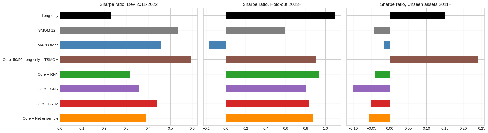

# ml-for-business-decisions

Notebooks from a course on machine learning for business decisions, plus two trading-strategy studies I built on top of it. Everything was written for Google Colab.



## Notebooks

| Notebook | What it does | Data |
|---|---|---|
| `notebooks/01_airline_tweets_eda.ipynb` | Loads the airline tweets dataset and previews it. A short first exercise. | Kaggle, download |
| `notebooks/02_kmeans_online_shoppers.ipynb` | Segments 12,205 online shopping sessions with K-means (k = 3) and checks the segments against purchases. | Included (UCI, CC BY 4.0) |
| `notebooks/03_regression_logistic_baseball.ipynb` | Linear regression of wins on runs scored, then logistic regression of playoff entry on wins, with train/test split and 5-fold CV. | Kaggle, download |
| `notebooks/04_image_classification_waste.ipynb` | Organic vs recyclable images: logistic regression on PCA features, an MLP and a small CNN in PyTorch. Needs a GPU. | Kaggle, download |
| `notebooks/order_book/order_book_prediction.ipynb` | Can the limit order book predict the next price move (down, time-out, up), and does it pay after the spread? CUSUM events, triple-barrier labels, purged walk-forward folds, and logistic regression, two MLPs, an LSTM and a CNN+LSTM. Needs a GPU. | FI-2010, downloaded at run time |
| `notebooks/trading_strategy/multi_asset_trend_carry_v6.ipynb` | Can an RNN, CNN or LSTM overlay improve a 50/50 long-only + 12-month trend portfolio of 38 ETFs? Purged walk-forward, weekly rebalancing, costs, block bootstrap. | yfinance and FRED, downloaded at run time |
| `notebooks/trading_strategy/aapl_meta_labeling_v7.ipynb` | Meta-labeling on AAPL: a 200-day trend rule picks the trades, and logistic regression, XGBoost or an attention LSTM decides whether to take or size each one. Trained on 30 large-cap stocks. | yfinance and FRED, downloaded at run time |

## Presentations and write-up

| File | For |
|---|---|
| [`reports/online_shoppers_clustering_slides.pdf`](reports/online_shoppers_clustering_slides.pdf) | Notebook 02: segments, conversion rates and a targeting scenario |
| [`reports/order_book_presentation.pdf`](reports/order_book_presentation.pdf) | Order book notebook: slides |
| [`reports/order_book_write_up.pdf`](reports/order_book_write_up.pdf) | Order book notebook: full write-up (data, leakage controls, models, business scenarios, limitations) |

## Results

From the saved notebook outputs, except the order book study, whose numbers come from the write-up (the notebook is saved without outputs).

- **02, online shoppers:** three segments. The largest (73% of sessions) converts at 14.7%, a small "quick exit" group (7%) at 0.6%, and a high-engagement group (20%) at 25.0%, against 15.6% overall. Spending a $10,000 budget only on the high-engagement group gives 498 expected conversions instead of 312. Silhouette score 0.41 at k = 3 in the saved run (0.37 in a re-run with scikit-learn 1.9, with the same cluster sizes and conversion rates).
- **03, baseball:** runs scored alone explain about 26% of the variance in wins (R-squared 0.26). Wins predict playoff entry with 0.91 test accuracy (F1 0.74 on the playoff class).
- **Order book:** on 9,567 test events every model beat the majority-class baseline (48 to 50% accuracy against 36.4%). The LSTM had the best macro F1 (0.44, logistic regression 0.38). It made 2.0 bps per trade before costs, but crossing the spread cost 15.1 bps, so it lost 13.1 bps per trade. Cost-aware labels and loss cut the loss to 9 bps per trade (31% less), mostly by trading less; no setup made money. A 76% confidence bar raised precision to 86.6% at 2% recall (164 trades).
- **v6, trend + neural overlays:** no overlay beat the plain core. The best one (Core + LSTM) had Sharpe 0.44 / 0.84 / -0.05 on development, 2023+ hold-out and unseen assets, against 0.59 / 0.91 / 0.24 for the core. It beat the core in 17% of bootstrap samples.
- **v7, meta-labeling:** the meta-models did not predict which trades win (development AUC between 0.46 and 0.50). The best meta strategy beat taking every trade in 28% of bootstrap samples, so the notebook recommends the plain rule.

Notebook 04 and the order book notebook have no saved outputs. 01 had its output cleared because it showed real tweets.

## How to run

In Colab: open a notebook, upload the data file it needs to `/content/data/` (or follow the note in its first cell) and use `Runtime > Run all`.

Locally:

```
python -m venv .venv
.venv\Scripts\activate          # Windows; use source .venv/bin/activate elsewhere
pip install -r requirements.txt jupyter
jupyter notebook notebooks/
```

Notebooks look for data in `data/` relative to the repo root (`../data` from `notebooks/`). See [data/README.md](data/README.md) for where to get each file. The trading notebooks download their own prices and write caches and results next to the notebook (`data/`, `results/`, both git-ignored). They take roughly 15 to 35 minutes each on a GPU. The order book notebook downloads FI-2010 into its own folder and saves caches, weights and CSV exports to `order-book-prediction/artifacts` (in My Drive on Colab, next to the notebook otherwise). Weights & Biases logging is optional.

## Limitations

- These are course exercises and personal experiments, not production code. Several notebooks repeat imports and set-up between cells.
- The order book study uses five Nordic stocks over ten days in 2010, assumes every trade fills at the quoted price, and earlier versions of the project looked at the test days, so test scores may be a little high.
- The trading studies use ETFs and today's large-cap stocks (survivorship bias in v7), flat 3 bps costs, and hold-out periods that earlier versions had already seen. Both notebooks list their caveats at the end. Nothing here is investment advice.

## Credits

- Online Shoppers Purchasing Intention dataset: Sakar et al., UCI Machine Learning Repository, doi:10.24432/C5F88Q, CC BY 4.0.
- FI-2010 limit order book dataset: Ntakaris et al. (2018), doi:10.1002/for.2543.

## License

Code: MIT, see [LICENSE](LICENSE). Datasets keep their own licenses (see `data/README.md`).
